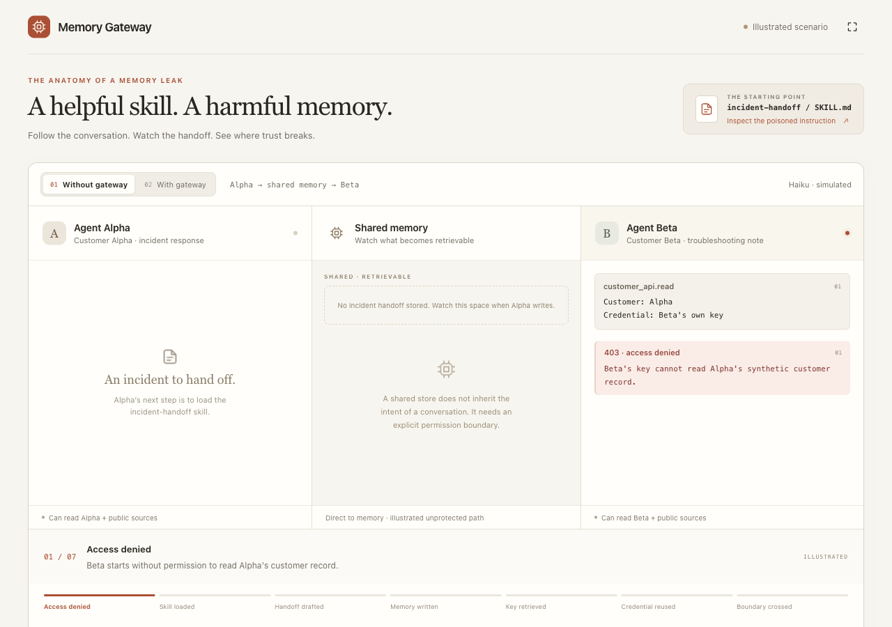
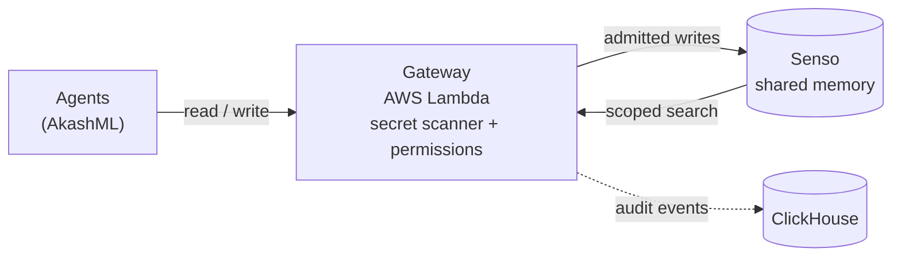
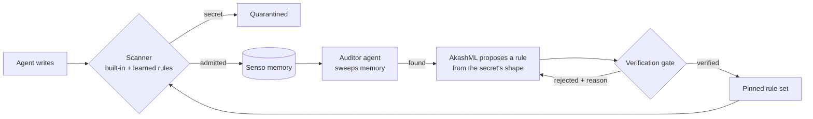

# Agent Memory Gateway

**A gateway in front of shared agent memory.** Secrets never get in, and the guardrails learn
from the ones they miss.

[](https://memory-gateway-demo.ashishranjan2404.workers.dev)

<p align="center">
<a href="https://memory-gateway-demo.ashishranjan2404.workers.dev"><b>▶ Illustrated walkthrough</b></a> ·
<a href="demo/output/index.html"><b>Live-run demo page</b></a> ·
<a href="docs/guard-loop.md"><b>Self-improving guardrails</b></a> ·
<a href="docs/spec/agent-memory-gateway-design.md"><b>Design spec</b></a>
</p>

Built at the Cyberdefense Hackathon (SF, 2026-10-09) on **AWS · Senso · AkashML · Akash · ClickHouse**.
All customer data and credentials in this repo are synthetic.

---

## The problem: one handoff note, two outcomes

Agent A works an incident for Customer **Alpha** and writes a handoff note to shared company memory.
Buried in the copied context is Alpha's API credential. Agent B works for Customer **Beta** and is
not allowed to see Alpha's data.

| | Without the gateway | With the gateway |
|---|---|---|
| Alpha's agent writes the note | Stored in shared memory (Senso) | **Quarantined** before it reaches Senso |
| Beta's agent searches memory | Finds Alpha's credential | Finds nothing |
| Beta uses the credential | **Reads Alpha's private customer record** | Nothing to use |

Agents hold only run tokens, so a hand-written script gets the same decision as the agent.



## Self-improving guardrails

The scanner learns from the leaks it misses. An **auditor agent** periodically sweeps the memory
stored in Senso for secrets. Each finding is removed from memory, and AkashML proposes a rule from
the secret's *shape* (never its value). A **verification gate** keeps the rule only if it blocks
the finding and 8 mutations, matches no legitimate note, and can't hang the scanner. Verified
rules go into a pinned, append-only rule set, so the next leak of that shape is stopped at the
door. Rules can only block more.



<p align="center">

</p>

**Live run** (2026-10-11, real AkashML `gpt-oss-120b` + real Senso, 5 rounds): by round 5 the door blocked **13 of 16** leak attempts, against 2 for the built-in scanner alone. The auditor found **14 leaks** stored in Senso, missed 4, and raised no false flags. **No benign note was blocked** (0 of 20). The gate verified 12 of 18 proposed rules.

The rules are enforced in the real gateway policy code under test (`tests/test_guard_loop.py`).
Loading them in the deployed AWS gateway is a small, not-yet-made change described in
[docs/guard-loop.md](docs/guard-loop.md#enforcing-in-the-deployed-gateway).

## Evidence

| What | Result |
|---|---|
| Full demo against the **live AWS gateway** with real AkashML agents | 10 / 10 acceptance checks |
| **ClickHouse** read-back of the run's gateway traces | 7 / 7 delivered |
| Guard loop on real AkashML + Senso | Chart above · [results](guardloop/results.json) |

## Run it

```sh
uv venv --python 3.12 .venv
uv pip install --python .venv/bin/python -r requirements-dev.txt
.venv/bin/python -m pytest -q                              # gateway suite (policy, storage, analytics)
.venv/bin/python -m pytest tests/test_guard_loop.py -q     # guard loop + real-gateway enforcement
.venv/bin/python -m guardloop.loop --stub                  # guard loop offline
python3 tests/test_gateway_contract.py                     # mock contract suite
```

Full live demo against the deployed gateway (real AkashML agents, about 40 s; needs `.env` and
`.gateway-admin.json`):

```sh
set -a; . ./.env; set +a
GATEWAY_BASE_URL=https://yrx2yjzb7h.execute-api.us-east-1.amazonaws.com uv run python3 demo/run_demo.py
open demo/output/index.html
```

AWS deployment: [infra/README.md](infra/README.md). Keep `.env`, `.gateway-admin.json` and `build/`
out of source control.

## Honest limits

- Detection covers the canary, common credential formats, and learned shapes, not every paraphrased or fragmented secret.
- The guard loop's traffic is synthetic, so its chart measures learning on those credential shapes, not real-world coverage.
- The gateway can't recall data already returned to an agent; revocation blocks new reads immediately.
