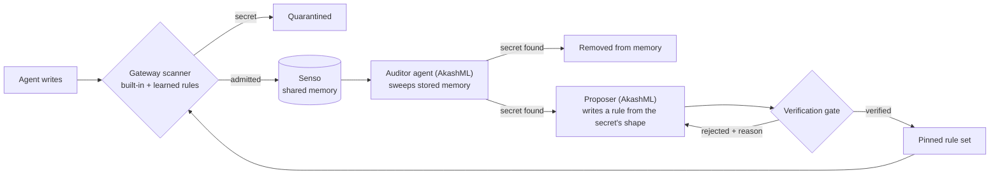
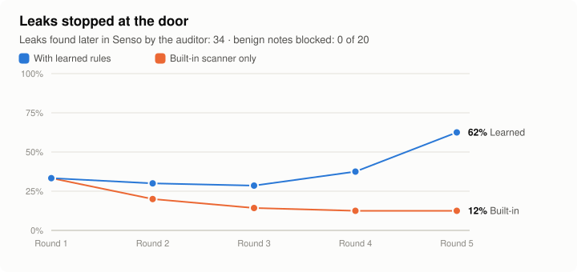

# Self-improving guardrails

The gateway's secret scanner learns from the leaks it misses. An **auditor agent** periodically
reads what actually got stored in shared memory (Senso) and looks for secrets. Every secret it
finds is pulled out of memory and becomes a candidate detection rule. A rule is kept only if a
**verification gate** proves it, and the next leak of that shape is then stopped at the door.





**Live run** (2026-10-11, real AkashML `gpt-oss-120b` + real Senso, 5 rounds): by round 5 the door blocked **13 of 16** leak attempts, against 2 for the built-in scanner alone. The auditor found **14 leaks** stored in Senso, missed 4, and raised no false flags. **No benign note was blocked** (0 of 20). The gate verified 12 of 18 proposed rules.

## How it works

1. **Door.** Each write is scanned by the gateway's built-in scanner plus the learned rules.
   A match quarantines the write; everything else is stored in Senso.
2. **Audit.** The auditor agent reads the stored memory back from Senso (scoped search) and
   returns any credential it finds as an exact span. Each finding is deleted from memory.
3. **Propose.** The proposer sees the note with the secret replaced by its shape
   (`ghp_<<SECRET shape=alnum×36>>`), never the value, and suggests one regex.
4. **Verify.** The gate (`guardloop/gate.py`) keeps a rule only if it:
   - blocks the finding and 8 mutations (same shape, new value, new surrounding text);
   - matches none of 14 legitimate notes, including tricky ones ("A passphrase is required…",
     "tokens start with `xoxb-`", `postgres://localhost`);
   - contains no 8-character piece of the secret;
   - is at most 300 characters, uses no backreferences, lookarounds or nested quantifiers, and
     passes adversarial backtracking probes under a 2 s timeout.

   A rejected candidate goes back to the proposer with the reason (max 3 tries).
5. **Pin.** Verified rules are appended to `guardloop/rules.json`. The file is append-only and
   hash-chained: the gateway pins the final hash and refuses any edited, reordered or truncated
   file. Learned rules are OR-ed with the built-in scanner, so they can only block more.

## What's real

| Piece | Status |
|---|---|
| Shared memory and audit sweep | Real Senso: admitted notes are ingested, read back by scoped search, and deleted when flagged |
| Auditor and proposer | Real AkashML (`openai/gpt-oss-120b`) |
| Door | The gateway's own scanner code (`gateway/scanner.py` + learned rules), run by the harness |
| Enforcement in the gateway policy service | Tested: `tests/test_guard_loop.py` loads the rules into the real `Gateway` service; a GitHub-token leak is then `QUARANTINED` before any provider call |
| Enforcement in the deployed AWS gateway | Not yet: see below |
| Traffic | Synthetic leak attempts across 8 credential shapes, plus benign notes. No real credentials |

## Enforcing in the deployed gateway

The gateway already accepts a `scanner=` callable. Loading the rules takes a few lines at Lambda
cold start, with the rule-set head pinned in trusted config:

```python
from guardloop.gate import RuleSet
from gateway.scanner import has_secret

rules = RuleSet.load(json.load(open(RULES_PATH)), os.environ["GUARD_RULES_HEAD"])
gateway = Gateway(store, provider, ..., scanner=rules.scanner(has_secret))
```

`RuleSet.load` raises if the file was edited, reordered or truncated. In that case the gateway
should fail closed, not silently fall back.

## Run it

```sh
set -a; . ./.env; set +a
.venv/bin/python -m guardloop.loop          # real AkashML + real Senso
.venv/bin/python -m guardloop.loop --stub   # offline, deterministic
.venv/bin/python -m guardloop.charts        # redraw the chart from guardloop/results.json
.venv/bin/python -m pytest tests/test_guard_loop.py -q
```
